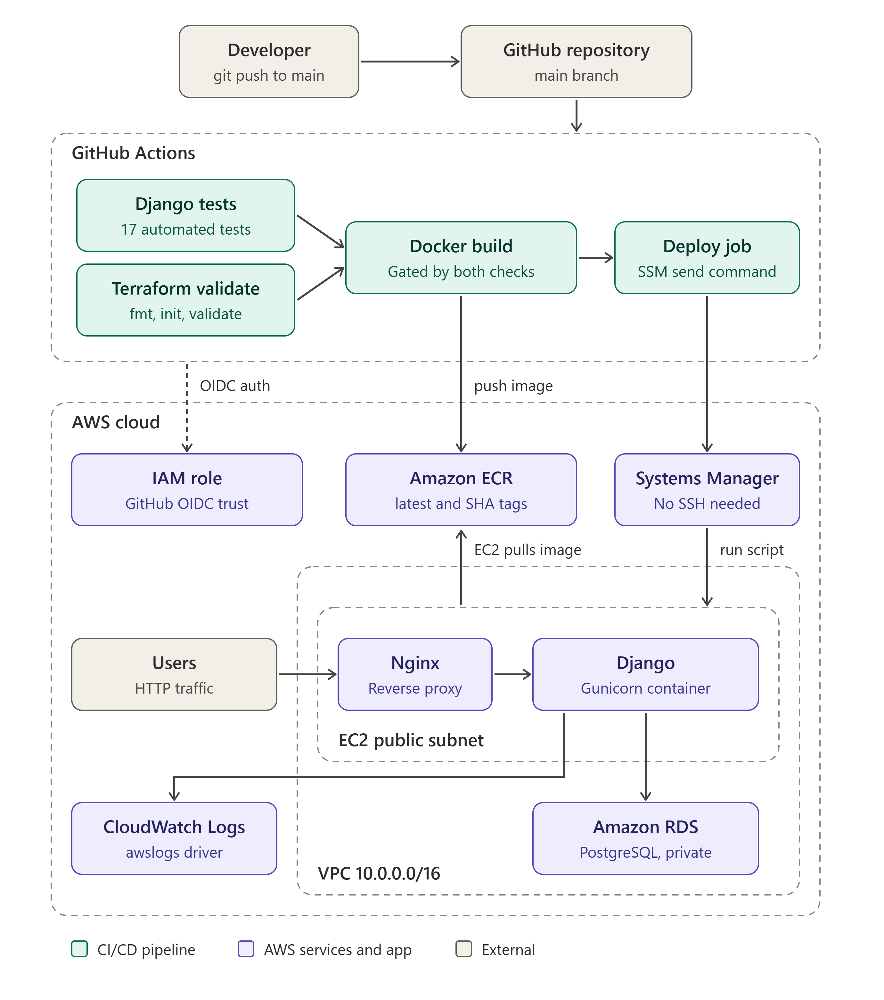
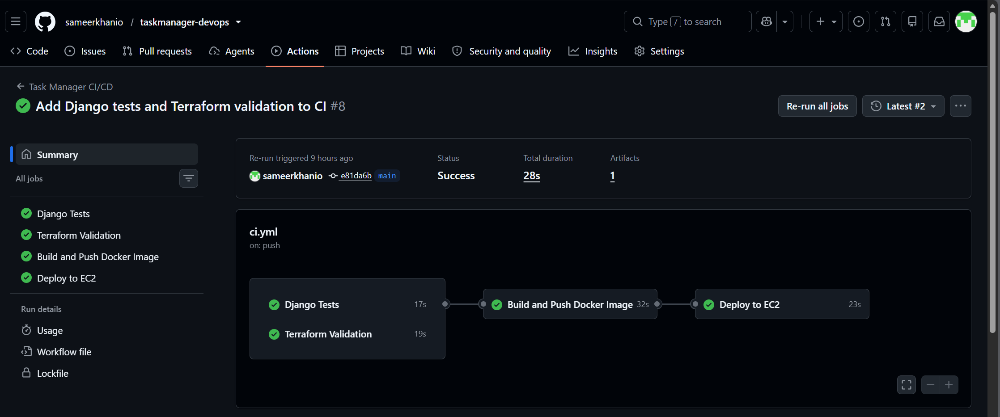
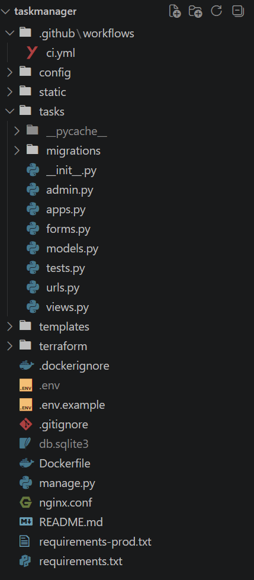

# Task Manager — AWS DevOps & CI/CD

A Dockerized Django task management application deployed on AWS using Terraform, Amazon ECR, GitHub Actions, and AWS Systems Manager.

The project demonstrates an end-to-end DevOps workflow: infrastructure provisioning with Infrastructure as Code, automated testing, infrastructure validation, container image publishing, remote deployment without SSH, health checks, tested rollback recovery, and centralized application logging.

---

## Architecture



## Tech Stack

| Category | Technologies |
|---|---|
| Application | Python, Django |
| Containerization | Docker |
| Web Server | Nginx, Gunicorn |
| Cloud Provider | AWS |
| Compute | Amazon EC2 (Amazon Linux 2023) |
| Database | Amazon RDS PostgreSQL 16 |
| Container Registry | Amazon ECR |
| Infrastructure as Code | Terraform |
| CI/CD | GitHub Actions |
| Deployment | AWS Systems Manager (SSM) |
| Monitoring & Logs | Amazon CloudWatch |
| Authentication | GitHub Actions OIDC, AWS IAM |

---

## AWS Infrastructure

All infrastructure is defined in Terraform.

### Networking

- Dedicated VPC using the `10.0.0.0/16` CIDR block.
- Public subnet for the EC2 application server.
- Two private subnets in separate Availability Zones for RDS.
- Internet Gateway and public route table.
- Security groups controlling application and database traffic.

### Compute

- Amazon EC2 running Amazon Linux 2023.
- Docker installed and enabled through EC2 user data.
- Nginx as a reverse proxy, Gunicorn serving the Django application.
- IAM instance profile attached to the instance.
- AWS Systems Manager used for remote deployment and management (no SSH required for CI/CD).
- Application container runs with a restart policy.

### Database

- Amazon RDS PostgreSQL 16 in private subnets.
- Encrypted 20 GB gp3 storage.
- Database security group allows PostgreSQL traffic only from the EC2 security group.

### Container Registry

- Amazon ECR repository with image scanning on push.
- Every deployment publishes two tags: `latest` and the Git commit SHA, so each running version is traceable to its source revision.

---

## CI/CD Pipeline

GitHub Actions runs on every push to the `main` branch.

### Pipeline Stages

**1. Django Tests**
- Installs dependencies and runs the Django test suite.
- 17 automated tests covering authentication, task operations, per-user data isolation, redirect safety, the Kanban board, dashboard counts, notes, and the health-check endpoint.

**2. Terraform Validation**
- `terraform fmt -check -recursive`
- `terraform init -backend=false`
- `terraform validate`

**3. Docker Build & Push**
- Builds the application image and authenticates with Amazon ECR.
- Publishes the `latest` and commit-SHA tags.

**4. Deployment through AWS SSM**
- Assumes an AWS IAM role using GitHub Actions OIDC.
- Sends deployment commands to EC2 through Systems Manager.
- Pulls the new image from ECR and runs database migrations.
- Starts the new container and performs HTTP health checks through Nginx.
- Switches the static-file directory only after the application passes health verification.

**5. Deployment Verification**
- GitHub Actions waits for the SSM command to finish and reads its result.
- The workflow fails if the remote deployment command fails.

### Pipeline Dependencies

```text
Django Tests ─────────────┐
                          ├──> Docker Build & Push ──> EC2 Deployment ──> Health Verification
Terraform Validation ─────┘
```

Docker publishing and deployment run only if both validation jobs succeed.

---

## Deployment Reliability & Rollback

### Deployment Strategy

1. Pull the new Docker image from ECR.
2. Run database migrations.
3. Preserve the currently running application container.
4. Start the new container.
5. Run HTTP health checks with retries.
6. Prepare and switch static files after the application passes health verification.
7. Remove the previous container and temporary backups after a successful deployment.

### Rollback Testing

A deployment failure was deliberately triggered to test recovery. The deployment script detected the failure, removed the failed new container, and restored the previously running container.

This verifies rollback for the tested scenario: a failed container deployment.

---

## Logging & Monitoring

Container logs are sent to Amazon CloudWatch Logs using Docker's `awslogs` driver.

- Log group: `/taskmanager/application`
- Retention: 7 days
- A separate log stream per deployment, identified by Git commit SHA.

This gives centralized access to startup and runtime logs without logging in to the EC2 instance.

---

## Security Practices

- GitHub Actions authenticates with AWS through OIDC and IAM role assumption; no long-lived AWS access keys are stored in GitHub.
- EC2 uses an IAM instance profile.
- RDS is deployed in private subnets, with access restricted to the EC2 security group.
- RDS storage is encrypted.
- Database credentials are supplied through an environment file on EC2, not baked into the Docker image.
- Deployments use Systems Manager instead of SSH-based CI/CD access.
- Per-user data isolation is covered by automated tests (users cannot read, edit, move, or delete each other's tasks and notes).

---

## Known Limitations

This is a single-instance deployment built to learn and demonstrate the workflow, not a production-grade setup. Current limitations:

- **No HTTPS.** Traffic is served over HTTP; a custom domain and TLS certificate are not configured yet.
- **No zero-downtime deployment.** The previous container is stopped while the new version starts, so a brief interruption can occur during a deploy.
- **Single EC2 instance.** No load balancer or Auto Scaling, so the application is not highly available.
- **Rollback covers the application container only.** Database migrations run before the container is replaced and are not reverted by rollback.
- **Credentials live in an environment file on EC2** rather than in AWS Secrets Manager or SSM Parameter Store.
- **Automated RDS backups are disabled for this disposable learning environment**. No independent database backup and recovery strategy is currently implemented.
- **Terraform is applied manually.** CI validates the configuration but does not run `terraform plan` or `apply`.

---

## Infrastructure Deployment

Prerequisites: an AWS account, Terraform, and AWS credentials configured locally.

```bash
cd terraform
terraform init
terraform fmt
terraform validate
terraform plan
terraform apply
```

Provide the required Terraform variables and sensitive values through your own `terraform.tfvars` (not committed to Git) before applying.

For the deployment workflow to work, you also need:

- The EC2 instance ID set as the GitHub Actions repository variable `EC2_INSTANCE_ID`.
- An IAM role with the required permissions, and a GitHub OIDC trust relationship configured for this repository.

---

## Local Development

### Prerequisites

- Python 3.12
- Docker
- Git

### Clone the Repository

```bash
git clone https://github.com/sameerkhanio/taskmanager-devops.git
cd taskmanager-devops
```

### Configure Environment Variables

Create a local `.env` file with the required Django and database settings. Keep credentials and environment files out of version control.

### Build and Run with Docker

```bash
docker build -t taskmanager .
docker run --rm --env-file .env -p 8000:8000 taskmanager
```

### Run Django Tests

```bash
docker run --rm --env-file .env -e DB_HOST= taskmanager python manage.py test tasks
```

Setting `DB_HOST` to empty makes the tests use the local SQLite configuration instead of connecting to the remote PostgreSQL database.

### Validate Terraform

```bash
terraform -chdir=terraform fmt -check -recursive
terraform -chdir=terraform init -backend=false
terraform -chdir=terraform validate
```

---

## Screenshots

 GitHub Actions run

  

---

## Project Highlights

- Terraform-provisioned AWS infrastructure: VPC, public and private subnets, EC2, RDS, ECR, IAM.
- GitHub Actions pipeline with test and validation gates before any build or deploy.
- Secure AWS authentication through GitHub OIDC, with no stored AWS keys.
- SSH-free deployment to EC2 through AWS Systems Manager.
- Commit-SHA tagged images in ECR for traceable deployments.
- HTTP health checks and a rollback mechanism that was tested with a deliberate failure.
- Centralized logging with CloudWatch.
- Private RDS PostgreSQL database.

---

## Future Improvements

- HTTPS with a custom domain and TLS certificate.
- Move credentials to AWS Secrets Manager or SSM Parameter Store.
- Store Terraform state in a remote backend (S3 with state locking).
- Automated RDS backup and recovery strategy.
- Run `terraform plan` on pull requests, plus a separate PR validation workflow.
- Application linting and expanded test coverage.
- Zero-downtime deployment strategy.
- CloudWatch metrics, alarms, and alerting.
- Application Load Balancer and Auto Scaling for high availability. A load-balanced, Auto Scaling version of this application was built separately in my earlier Task Manager project.

---

## Repository Structure

 

---

## Author

**Muhammad Sameer Khan**
Cloud Computing Student | AWS | DevOps

- GitHub: [sameerkhanio](https://github.com/sameerkhanio)
- LinkedIn: [Sameer Khan](https://www.linkedin.com/in/sameerkhanio/)

*Built as a hands-on project to practice infrastructure automation, containerized deployments, and cloud operations on AWS.*
